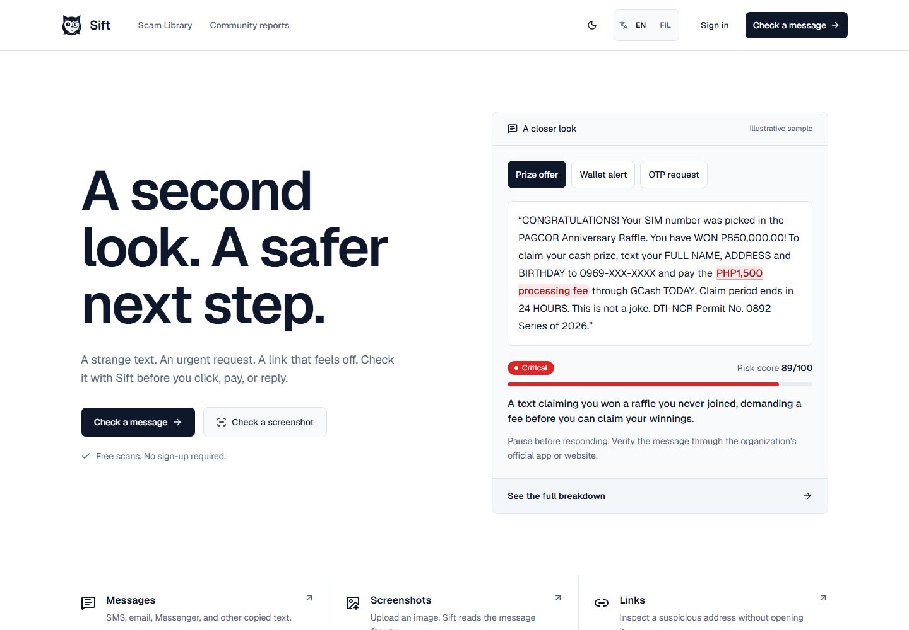

<div align="center">
  <picture>
    <source media="(prefers-color-scheme: dark)" srcset="public/brand/sift-owl-white.svg" />
    
  </picture>

  <h1>Sift</h1>
  <p><strong>A second look. A safer next step.</strong></p>
  <p>Check suspicious messages, screenshots, and links for Philippine scam patterns.</p>

  <p>
    
    
    
    
    
    <a href="https://github.com/eloooong/sift-web/actions/workflows/ci.yml"></a>
  </p>

  <p>
    <a href="#features">Features</a> ·
    <a href="#getting-started">Getting started</a> ·
    <a href="#configuration">Configuration</a> ·
    <a href="#documentation">Documentation</a> ·
    <a href="https://github.com/eloooong/sift-web/issues">Report an issue</a>
  </p>
</div>

## Preview



_The homepage uses an illustrative message to show the risk assessment, evidence, and recommended next step._

## Overview

A strange text, an urgent payment request, or a link that feels off. Sift helps Filipino internet users examine the warning signs before clicking, paying, or replying. Results explain what contributed to the risk score and suggest practical ways to verify the request.

Message and link checks work without an account or an AI API key. Optional accounts add private scan history; optional services add AI-assisted message analysis and URL reputation checks.

> Sift is an independent educational tool. A low risk score does not guarantee safety. Verify consequential requests through the organization's official app, website, or contact channel.

## Features

| Area | What it provides |
| --- | --- |
| **Message checks** | Detect scam signals in English, Filipino, and Taglish, including urgency, impersonation, payment demands, and suspicious links. |
| **Screenshot checks** | Extract text with server-side Tesseract OCR, then run the message analysis pipeline. |
| **Link checks** | Inspect URL structure without visiting the submitted address, with optional Google Safe Browsing reputation checks. |
| **Explained results** | Show a 0–100 risk score, detected signals, supporting evidence, and recommended actions. |
| **Private history** | Save signed-in scans to an account, revisit results, and delete individual entries or all history. |
| **Community reports** | Accept submissions for moderator review and publish approved reports. New stores start empty. |
| **Scam library and insights** | Browse common scam patterns and research aggregates, separate from personal scan history. |
| **Interface** | English and Filipino navigation and scanner copy, responsive layouts, day and night themes, keyboard controls, and reduced-motion support. |

### How a check works

1. **Bring the message.** Paste text, upload a screenshot, or submit a link.
2. **Review the evidence.** Read the warning signs and the explanation behind the risk score.
3. **Choose a safer next step.** Use the recommendations to pause, verify, block, or report the request.

The message pipeline starts with deterministic rules. When AI analysis is configured, its validated response contributes to the result; failures fall back to the rules. Screenshot checks use the same pipeline after OCR.

## Technology

| Layer | Stack |
| --- | --- |
| Application | Next.js App Router, React 19, TypeScript |
| Interface | Tailwind CSS 4, shadcn/ui, Radix UI, Lucide, Motion |
| Analysis | Message rules, URL heuristics, optional AI and reputation services |
| OCR | Tesseract.js with a reusable server-side worker |
| Storage | PostgreSQL through `pg`; process-local memory for development without a database |
| Accounts | Server-managed sessions, HTTP-only cookies, salted scrypt password hashes |
| Verification | Regression scripts, Node.js test runner through `tsx`, ESLint, TypeScript, Impeccable design lint |

## Getting started

### Requirements

- **Node.js 22.18 or newer** and npm. CI uses Node.js 22, as specified in [`.nvmrc`](.nvmrc).
- Internet access for dependency installation and the first OCR language-data download.
- PostgreSQL when you need durable accounts, history, reports, and shared rate limits.

### 1. Clone and install

```sh
git clone https://github.com/eloooong/sift-web.git
cd sift-web
npm ci
```

### 2. Configure your environment

```sh
cp .env.example .env.local
```

On PowerShell, use `Copy-Item .env.example .env.local`.

You can leave service credentials blank to explore the rule-based scanners. Without `DATABASE_URL`, accounts, sessions, history, reports, and rate limits use temporary process memory. Restarting the server clears that state; separate instances do not share it.

### 3. Start the application

```sh
npm run dev
```

Open [localhost:3000](http://localhost:3000).

## Configuration

Keep credentials in `.env.local` or deployment environment variables. Start with [`.env.example`](.env.example); the service options below are read by the application.

| Variable | Purpose |
| --- | --- |
| `DATABASE_URL` | PostgreSQL connection string. Required for durable or multi-instance deployments. |
| `DATABASE_SSL_CA` | Optional PEM root certificate for a database using a private CA. Explicit SSL settings in `DATABASE_URL` take precedence. |
| `AI_API_KEY` | Enables optional AI-assisted message analysis. |
| `AI_BASE_URL`, `AI_MODEL`, `AI_TIMEOUT_MS` | Compatible API endpoint, model, and timeout overrides. |
| `GOOGLE_SAFE_BROWSING_API_KEY` | Enables optional URL reputation checks. |
| `OCR_PROVIDER`, `OCR_LANGUAGES`, `OCR_TIMEOUT_MS`, `OCR_CACHE_DIR` | OCR provider, recognition languages, timeout, and cache location. Defaults to Tesseract with English recognition. |
| `MODERATION_TOKEN` | Private token for `/reports/moderation`. The queue stays locked when unset. |
| `NEXT_PUBLIC_SITE_URL` | Public canonical URL for metadata and sitemap generation. |

After configuring PostgreSQL, apply the schema:

```sh
npm run db:migrate
```

Remote database connections default to certificate-verified TLS. Keep database and moderation credentials server-side. See [SECURITY.md](SECURITY.md) for session handling, uploads, proxy configuration, and storage boundaries.

## Development

| Command | Purpose |
| --- | --- |
| `npm run dev` | Start the development server. |
| `npm run check` | Run lint, route-type generation, TypeScript, regression tests, and design lint. |
| `npm test` | Run scanner, validation, authentication, ownership, and request-guard regression suites. |
| `npm run typecheck` | Generate Next.js route types and check TypeScript. |
| `npm run lint:design` | Check interface rules with Impeccable. |
| `npm run db:migrate` | Apply PostgreSQL migrations. |
| `npm run build` | Create a production build. |
| `npm start` | Serve the production build. |

Before submitting a change:

```sh
npm run check
npm run build
```

GitHub Actions runs installation, a dependency audit, lint, type checks, regression tests, design lint, and a production build on pushes and pull requests to `main`.

Tests use isolated memory stores and mocked provider contracts. They do not connect to a developer's database or require external service credentials. Real OCR recognition, live PostgreSQL behavior, and external providers need separate environment-specific verification. For interface changes, also check desktop and mobile, keyboard navigation, both languages, and both themes.

## Deployment

Use a host that supports the Next.js Node.js runtime and Tesseract's worker and WebAssembly dependencies. Build and serve with:

```sh
npm run build
npm start
```

Configure PostgreSQL and run migrations before relying on persistent accounts or history. Set `NEXT_PUBLIC_SITE_URL` to the public origin, serve over HTTPS for secure session cookies, and configure the reverse proxy's forwarding headers deliberately. OCR needs a writable cache location and access to language data on first use.

## Project structure

```text
src/
  app/                 Pages, API routes, metadata, and global styles
  components/          Scanner, account, report, dashboard, and shared UI
  lib/
    scam-detector/     Message signals, scoring, and classification
    url-analyzer/      URL parsing, signals, and optional reputation
    ocr/               OCR provider and Tesseract worker
    auth/              Passwords, sessions, and account storage
    history/           Private scan history and ownership checks
    reports/           Community submissions, moderation, and rate limits
    db/                PostgreSQL access and TLS configuration
    i18n/              English and Filipino interface copy
db/migrations/         PostgreSQL schema migrations
scripts/               Regression checks and migration runner
tests/                 Security and behavior regression tests
docs/                  Architecture and interface screenshots
public/brand/          Sift owl assets
```

## Documentation

- [Architecture](docs/architecture.md) — analysis pipelines, identity, persistence, and service boundaries.
- [Contributing](CONTRIBUTING.md) — development workflow, code conventions, and verification.
- [Security](SECURITY.md) — implemented controls, deployment requirements, and known limits.
- [Design system](DESIGN.md) — visual tokens, layout, typography, and motion conventions.
- [Environment template](.env.example) — initial local configuration.

## Data and limitations

The insights page presents research aggregates, not the current visitor's activity or live national incident counts. Homepage examples and library messages illustrate scam patterns. Source references are retained in the [message dataset](src/lib/dataset/ph-scam-messages.ts) and [dashboard data](src/lib/dashboard/demo-data.ts). Community number lookups use the [PH Scam DB](https://github.com/wgtechlabs/ph-scam-db) feed.

Community reports are separate from private history. New stores contain no fictional submissions or confirmation counts. Earlier versions inserted sample reports automatically; existing database rows are retained and should be reviewed separately before deployment.

The classifier can miss new tactics and flag legitimate messages. OCR can misread text, and optional AI or reputation services can be unavailable or incorrect. Review the evidence and verify requests through official channels.

## Credits and licensing

Built with the open-source tools listed above, including [Tesseract.js](https://github.com/naptha/tesseract.js), [shadcn/ui](https://ui.shadcn.com/), and [Lucide](https://lucide.dev/). Third-party code, source datasets, and bundled fonts retain their respective terms. This repository does not currently include a project-wide license.

Maintained by [eloooong](https://github.com/eloooong).
